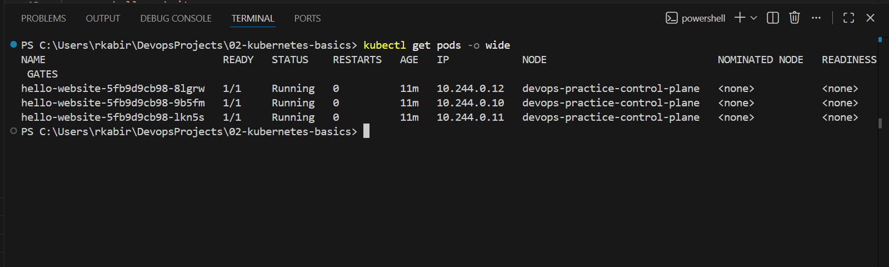
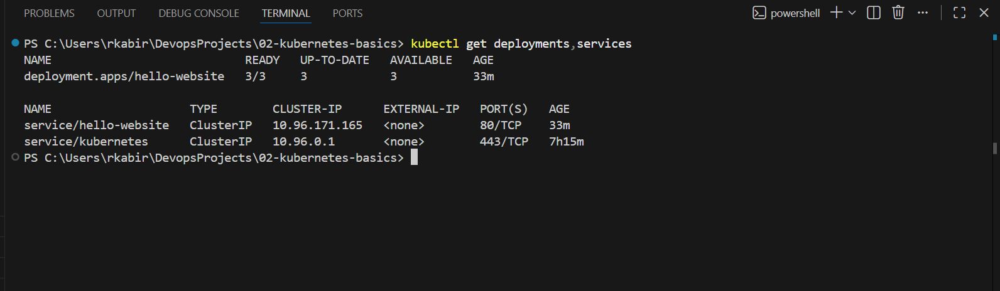
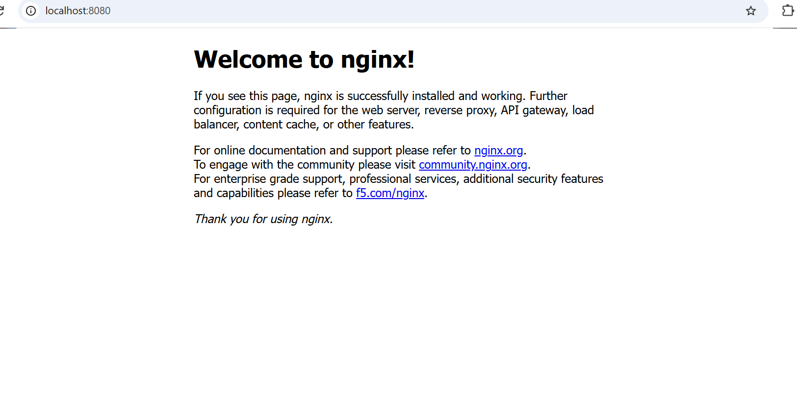

# Kubernetes Nginx Deployment — DevOps Portfolio Project

## Project Overview

This project demonstrates how to deploy, manage, scale, and troubleshoot a containerized Nginx web application using Kubernetes.

I built and tested the project locally using **Kind (Kubernetes in Docker)**, Docker Desktop, kubectl, and VS Code on Windows.

The project covers essential Kubernetes concepts and practical DevOps operations, including rolling updates, self-healing, resource management, and deployment rollback.

## Technologies Used

- Kubernetes
- Kind (Kubernetes in Docker)
- Docker Desktop
- kubectl
- Nginx
- YAML
- Windows PowerShell
- Visual Studio Code

## Architecture

```text
Windows Browser
      |
      | localhost:8080
      |
kubectl port-forward
      |
      v
Kubernetes Cluster (Kind)
      |
      v
ClusterIP Service (hello-website)
      |
      v
Nginx Deployment (3 replicas)
      |
      +-- Nginx Pod 1
      +-- Nginx Pod 2
      +-- Nginx Pod 3
```

The Kubernetes Service provides a stable network endpoint for the Nginx pods. Port forwarding allows the application to be accessed locally.

## Project Structure

```text
02-kubernetes-basics/
├── README.md
├── website.yaml
└── screenshots/
    ├── 01-running-pods.png
    ├── 02-deployment-service.png
    └── 03-nginx-website.png
```

## Kubernetes Configuration

The `website.yaml` manifest defines:

**Deployment**
- Three Nginx replicas
- Container image: `nginx:stable-alpine`
- Readiness probe to check whether the application can receive traffic
- Liveness probe to detect an unhealthy application
- CPU and memory requests and limits

**Service**
- Name: `hello-website`
- Type: `ClusterIP`
- Service port: `80`
- Container target port: `80`

### Resource Configuration

| Resource | Request | Limit |
|---|---|---|
| CPU | 100m | 250m |
| Memory | 64Mi | 128Mi |

Resource requests help Kubernetes schedule pods, while limits control container resource usage.

## How to Run the Project

### Prerequisites

Install and configure:

- Docker Desktop
- kubectl
- Kind

Make sure Docker Desktop is running.

### 1. Create a Kubernetes Cluster

```powershell
kind create cluster --name devops-practice
```

Verify the node:

```powershell
kubectl get nodes
```

### 2. Deploy Nginx

From the project directory, run:

```powershell
kubectl apply -f website.yaml
```

Check the Deployment and pods:

```powershell
kubectl get deployments
kubectl get pods
```

Wait until all three pods are ready.

### 3. Access the Website

```powershell
kubectl port-forward service/hello-website 8080:80
```

Open the browser:

http://localhost:8080

The default Nginx welcome page should appear.

## DevOps Tests Performed

### 1. Application Scaling

Scaled the Nginx Deployment from one replica to three replicas:

```powershell
kubectl scale deployment hello-website --replicas=3
```

Verified that Kubernetes successfully created three running pods.

### 2. Kubernetes Self-Healing

Deleted one running Nginx pod to simulate a pod failure:

```powershell
kubectl get pods
kubectl delete pod <actual-pod-name>
```

Observed Kubernetes automatically create a replacement pod to maintain the desired replica count of three.

**Result:** The Deployment recovered to 3/3 ready replicas.

### 3. Resource Requests and Limits

Configured CPU and memory requests and limits in `website.yaml`.

Verified the live configuration using:

```powershell
kubectl get deployment hello-website -o yaml
```

**Result:** The Deployment had the expected CPU and memory settings.

### 4. Rolling Update

Updated the Deployment configuration and applied the manifest:

```powershell
kubectl apply -f website.yaml
kubectl rollout status deployment/hello-website
```

**Result:** Kubernetes completed the rolling update successfully, with three healthy replicas.

### 5. Failed Deployment and Rollback

Simulated a deployment failure using an invalid Nginx image tag:

```powershell
kubectl set image deployment/hello-website nginx=nginx:invalid-demo-tag
```

Observed an image pull failure.

Rolled back to the previous working Deployment:

```powershell
kubectl rollout undo deployment/hello-website
```

Verified recovery:

```powershell
kubectl rollout status deployment/hello-website
kubectl get deployments
kubectl get pods
```

**Result:** The Deployment returned to three healthy replicas using the working Nginx image.

## Screenshots

### Three Healthy Kubernetes Pods



### Deployment and Service



### Nginx Website



## Key Skills Demonstrated

- Creating and managing a local Kubernetes cluster
- Writing Kubernetes Deployment and Service manifests
- Deploying containerized applications
- Scaling application replicas
- Testing Kubernetes self-healing
- Configuring readiness and liveness probes
- Managing CPU and memory resources
- Performing rolling updates
- Troubleshooting image pull failures
- Rolling back unsuccessful deployments
- Verifying application health using kubectl

## Cleanup

Delete the application resources:

```powershell
kubectl delete -f website.yaml
```

Delete the local Kubernetes cluster when it is no longer needed:

```powershell
kind delete cluster --name devops-practice
```

## Project Outcome

Successfully deployed and managed a three-replica Nginx application in a local Kubernetes environment.

Demonstrated practical Kubernetes operations including scaling, self-healing, resource management, rolling updates, failure simulation, and rollback.

This project was created as part of my hands-on learning journey toward a junior DevOps engineering role.